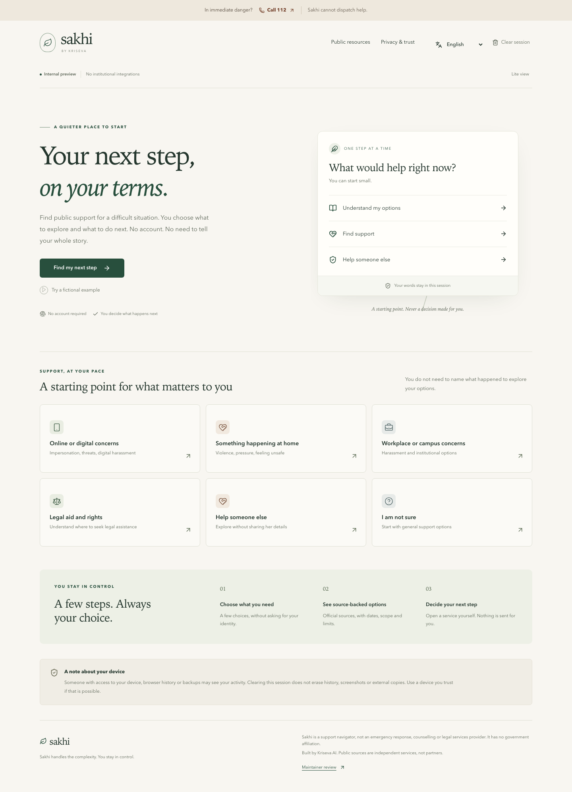
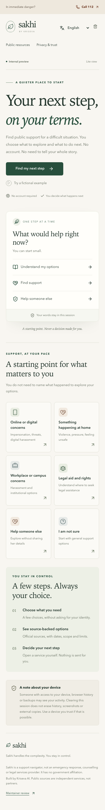
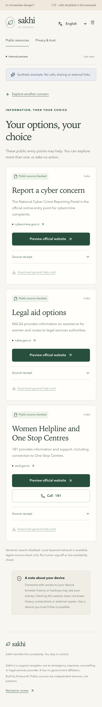
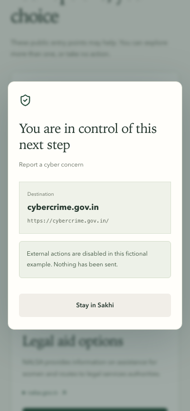
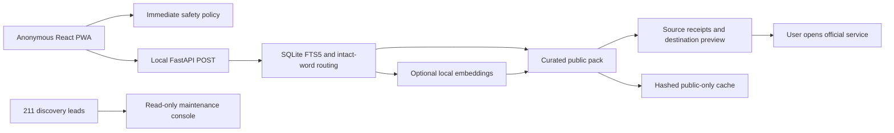

<div align="center">

# sakhi

**Sakhi handles the complexity. You stay in control.**

A local, source-backed starting point for women exploring public support in India.

`Internal preview` · `Apache-2.0 project code` · `No paid API key` · `No institutional integrations`

</div>

**Sakhi is not an emergency, counselling or legal services provider. For immediate danger in India, call 112 if you can.** [Official emergency information](https://112.gov.in/). No government affiliation or guaranteed service availability is claimed.

**Device safety:** someone with access to your device, browser history or backups may see your activity. Clearing Sakhi does not erase those copies or make browsing untraceable.

<table>
<tr><td width="70%"></td><td width="30%"></td></tr>
</table>

## Start locally

From this checkout, Docker is the shortest path:

```sh
docker compose up --build
```

Open **[http://127.0.0.1:8787/en-IN/](http://127.0.0.1:8787/en-IN/)**. The container binds to loopback, runs as a non-root user and stores no private cases. No account, API key or model download is needed. The image build and runtime were tested on this Mac using Linux containers. First-time downloads determine setup time; no 60-second guarantee is made.

Prefer native development:

```sh
make setup
make dev
```

Open **[http://127.0.0.1:5173/en-IN/](http://127.0.0.1:5173/en-IN/)**. Requirements: Node 22+, uv, Python 3.13 (uv can install the pinned runtime), Make and a browser. `make setup` installs locked Node/Python dependencies and Chromium for tests. The launcher refuses occupied ports instead of replacing a listener. Ctrl+C stops its own processes.

| Environment | Observed state |
| --- | --- |
| macOS, Node 25.9.0, uv 0.11.6, Python 3.13.13, 24 GiB RAM | Native setup, dev and verification run |
| Linux container, Node 22 build, Python 3.13 runtime | Docker build and HTTP runtime run |
| Linux contributor host | CI workflow prepared; remote execution not observed |
| Windows | Use Docker Desktop or WSL2; native Windows host not tested |

A GitHub remote has not been created. After publication, clone the actual repository URL and run these commands. No placeholder repository, CI badge, public deployment or release tag is presented as real.

## One real journey

Choose **Understand my options → 18 or older → Online or digital concerns**, or enter the fictional sentence “Someone made an impersonation account of me.” Sakhi returns public cybercrime and legal-aid options with official source receipts. Preview the exact hostname, consider device privacy, then decide whether to open the website. No complaint or referral is submitted.

The landing-page **Try a fictional example** mode visibly disables calls, outbound links and sharing. It never simulates an acknowledgement. See the [60-second synthetic storyboard](docs/DEMO.md).

<table>
<tr><td width="50%"></td><td width="50%"></td></tr>
</table>

Illustrative before/after, with no measured time-saving claim:

| Without the navigator | With this local preview |
| --- | --- |
| Guess which institutions are relevant, search across portals and inspect their scope | Choose a goal, see a few source-backed alternatives and inspect their limits |
| Decide independently what to disclose on each official service | Preview the destination; Sakhi transfers no story or form fields |

## What works, and what does not

| Capability | Actual state |
| --- | --- |
| Anonymous guided discovery and three-selection route from a direct goal | Functional locally |
| Immediate 112 CTA, explicit minor stop and general uncertainty fallback | Functional locally; finite phrase rules have limits |
| Local SQLite FTS5 BM25 plus intact Indic word matching | Functional without models |
| Source dates, expiry warnings, coarse jurisdiction and official hostname preview | Functional locally; 181 West Bengal exception preserved |
| Clear ephemeral session, pending-request cancellation, no sensitive persistence | Functional locally |
| Generic public-card downloads, lite view and synthetic sandbox | Functional locally |
| Hash-checked public-only PWA cache and offline reload | Browser tested; no live-service promise |
| 16 language shells, mid-session switch and RTL | Structurally complete; all require human review |
| Read-only source/locale/evaluation console and 211-lead ingestion | Functional locally; no private interactions shown |
| Optional EmbeddingGemma 2 ranking | Actual local execution measured; disabled by default |
| Expert bystander advice and fully reviewed multilingual guidance | Review blocked |
| Private vault, personal drafts, timelines, uploads, voice and reminders | Not available; P1 deferred |
| Provider handoffs, OSC appointment automation, submissions and acknowledgement tracking | Not available; partner authorization required |

All **68 candidate capabilities** have honest individual states in [FEATURES.json](FEATURES.json) and [the feature inventory](docs/FEATURES.md). This is not a claim that all 68 work. [Issue bodies](docs/ISSUE_BACKLOG.md) are prepared locally; no remote Issues exist. P1/P2 remain disabled until P0 review gates pass.

## Public sources and directory coverage

**211 discovery leads ingested · 7 agent-reviewed and curated for this preview · 0 human production approvals · 7 exposed public entry points.** Leads are not APIs. Public reading, service cost, open-source licensing and permission to integrate are separate facts.

The curated pack contains official emergency, women/child helpline, NALSA, cybercrime, SHe-Box and NCW entry points. Each has exact provenance, scope, check date, expiry and limitations. Some direct fetches failed or differed between tools; a source check does not establish live availability. [Inspect the canonical pack](data/public-seeds/resources.json) and [link-health observations](docs/evidence/resource-validation.json). Source review date: **2026-10-19**. Specialized recommendations expire; generic official entry points retain explicit stale warnings as a fallback.

**OSC coverage:** the [August 5, 2026 government report](https://www.pib.gov.in/PressReleasePage.aspx?PRID=2294887&lang=1&reg=1) reported 991 operational centres using data through June 30, 2026. Sakhi holds **0 individually sourced centre records, 0 independently verified centre contacts and 0 authorized provider integrations**. It does not fabricate 991 entries or claim access to a national provider API.

See [provenance](docs/DATA_PROVENANCE.md), [maintenance](docs/MAINTAINER.md) and the [empty sourced OSC registry](data/public-seeds/osc-registry.json). The HSDS-inspired reference export does not claim full standard conformance or institutional interoperability.

## Local AI, without generated safety advice

| Default zero-model mode | Optional local model mode |
| --- | --- |
| Deterministic safety policy and local lexical retrieval | Same policy with semantic ranking inside approved candidates |
| No API credentials or model weights | Explicit publisher download; no paid API |
| Small runtime and public-only data | Observed model cache 1.53 GB, CPU float32, 768 dimensions |
| Tested lexical fallback if optional engine is absent | Failures degrade to lexical results |

```sh
make model
HF_HUB_OFFLINE=1 TRANSFORMERS_OFFLINE=1 SAKHI_EMBEDDINGS=1 \
  uv run --group embeddings python scripts/dev.py
```

`make model` explicitly downloads the pinned public checkpoint after the Apache-2.0 acknowledgement built into that command. Read the [publisher model card](https://ai.google.dev/gemma/docs/embeddinggemma/model_card_2) first. The weights are not committed or included in Docker. Downloaded files include the publisher's multimodal checkpoint; runtime disables vision/audio encoders. The measured host has 24 GiB RAM; smaller-device model capacity was not tested. Core mode does not need a GPU.

EmbeddingGemma is an **encoder, not a generative model or legal reasoning engine**. It cannot write a hotline, allegation, eligibility rule or deadline. Standalone semantic ranking performed worse than the lexical baseline on several small language samples, so it does not control scope or emergencies. BHASHINI, IndicTrans2, voice and a local instruction model are not installed integrations. BHASHINI would require separate registration/approval.

## Language status

Every shell contains **133/133 keys**. Non-English shells have 20 draft navigation translations and **113 explicit English fallback entries**, with a visible notice. Key coverage is not translation completeness or quality. Even English safeguarding content has no external expert signoff.

| Locale | Language/script | Structural keys | Human review |
| --- | --- | --- | --- |
| en-IN | English | 133/133 | Pending |
| hi-IN | हिन्दी | 133/133 | Pending |
| bn-IN | বাংলা | 133/133 | Pending |
| mr-IN | मराठी | 133/133 | Pending |
| te-IN | తెలుగు | 133/133 | Pending |
| ta-IN | தமிழ் | 133/133 | Pending |
| gu-IN | ગુજરાતી | 133/133 | Pending |
| kn-IN | ಕನ್ನಡ | 133/133 | Pending |
| ml-IN | മലയാളം | 133/133 | Pending |
| or-IN | ଓଡ଼ିଆ | 133/133 | Pending |
| pa-IN | ਪੰਜਾਬੀ, Gurmukhi | 133/133 | Pending |
| as-IN | অসমীয়া | 133/133 | Pending |
| ur-IN | اردو, RTL | 133/133 | Pending |
| ne-IN | नेपाली | 133/133 | Pending |
| kok-IN | कोंकणी, Devanagari | 133/133 | Pending |
| ks-Arab-IN | کٲشُر, Perso-Arabic, RTL | 133/133 | Pending |

[Translation review process](docs/TRANSLATION_REVIEW.md). No speech or transcription support is implied by language selection.

## Architecture



No private-user datastore or institutional connector exists. Request text stays out of URLs, logs, caches and persistent storage. Only the non-sensitive locale preference is saved. Strict schemas, confidential validation errors, trusted hosts, CSP, no-referrer, disabled device sensors and disabled framework telemetry are implemented. Clearing state cancels pending navigation so a delayed response cannot restore it. External websites and device/OS copies remain outside Sakhi's control.

See [architecture](docs/ARCHITECTURE.md), [ADRs](docs/ADRs/001-local-architecture.md), [OpenAPI](packages/contracts/openapi.json), [API guide](docs/API.md), [privacy](docs/PRIVACY.md), [safety](docs/SAFETY.md), [threat model](docs/THREAT_MODEL.md) and [responsible-use terms](docs/TERMS.md).

## Verify and inspect

```sh
make verify
make evaluate
PYTHONPATH=. uv run python scripts/resources.py validate
# Explicit maintainer-only public link check, never driven by a private story:
PYTHONPATH=. uv run python scripts/resources.py validate --online
# Optional model comparison after make model:
PYTHONPATH=. uv run --group embeddings python scripts/model_benchmark.py
```

`make verify` runs Ruff, Python tests, browser-local tests, catalog/data checks, a production build, draft scenario evaluation and Playwright. It exits non-zero on failures. Application tests use only local/synthetic inputs and do not call real services. Link maintenance and model download are separate explicit online actions.

Measured on 2026-10-19: local Chromium lab Lighthouse **99 performance / 100 accessibility / 100 best practices**. Required widths 320, 360, 375, 390, 414, 768, 1024, 1280 and 1440 are exercised. Axe scans cover the landing at every width, other main surfaces at 320/1440 and selected Indic/RTL shells. Browser tests also cover cancellation, session erase, minors, keyboard focus, stale packs, language switch, offline reload and no automatic external requests. 200%/400% reflow equivalents use 640/320 CSS-pixel widths; physical zoom, TalkBack/VoiceOver and physical Android remain unverified.

The **410 draft routing cases** are in-sample, include generated surface variants and have no expert labels. The **104 authored-phrase model comparison** is also small and in-sample. Passing these does not establish real-world accuracy or emergency detection reliability. Per-language scores, timing, known limits and test counts are in the [release report](docs/RELEASE_REPORT.md) and [evidence directory](docs/evidence).

No physical Wi-Fi-off cold-start test was performed. Browser offline reload is a narrower observation. Offline resources cannot promise phone connectivity, current service availability or official submissions. Chromium installability diagnostics reported no errors; physical installation is not claimed.

## Configuration and operations

| Setting | Type/default | Purpose |
| --- | --- | --- |
| SAKHI_EMBEDDINGS | string `0` / unset | Set `1` only with explicit optional dependencies and local cache |
| SAKHI_ALLOWED_HOSTS | comma-separated loopback names | Host validation; configure explicitly behind a reviewed proxy |
| SAKHI_WEB_DIST | path, apps/web/dist | Production static bundle location |
| HF_HUB_OFFLINE / TRANSFORMERS_OFFLINE | string `1` recommended at model runtime | Prevent inference-time downloads |

No environment file or secret is required for core operation. No automatic dotenv loader exists. Ports: 5173 web, 8765 local API, 8787 container; test production server 8767. Keep no-access-log settings. Before external exposure, obtain security/safeguarding review, HTTPS, ingress rate limiting and a real private disclosure channel. No production hardening certification is claimed.

## Contribute carefully

A public-resource correction can be prepared locally from the trust page. It never publishes automatically. Propose a pull request with the authoritative source, date, scope and nonsensitive diff. Human verification and review are required for critical contacts. Follow [CONTRIBUTING](CONTRIBUTING.md), [maintainer guidance](docs/MAINTAINER.md), [community conduct](CODE_OF_CONDUCT.md) and [SECURITY](SECURITY.md). **Do not put personal cases, intimate images, private contacts or credentials in GitHub Issues.**

Good first contributions: an independently reviewed source, native-language review, a synthetic held-out case, a physical-device accessibility check or a reproducible setup on another OS. [Roadmap](ROADMAP.md) and [release gates](docs/RELEASE_GATES.md) state what is missing. Private vaults need a separate security design; provider APIs need written agreements, authentication, trained partners and observable acknowledgements.

Project code: [Apache-2.0](LICENSE). Dependencies, native fonts, public sources and the optional model retain their own terms. [Notices and license-review limits](docs/THIRD_PARTY_NOTICES.md). Source links and OSS acknowledgements do not imply endorsement.

_Last resource review: 2026-10-19. Local preview only. No public release tag or hosted crisis service._
