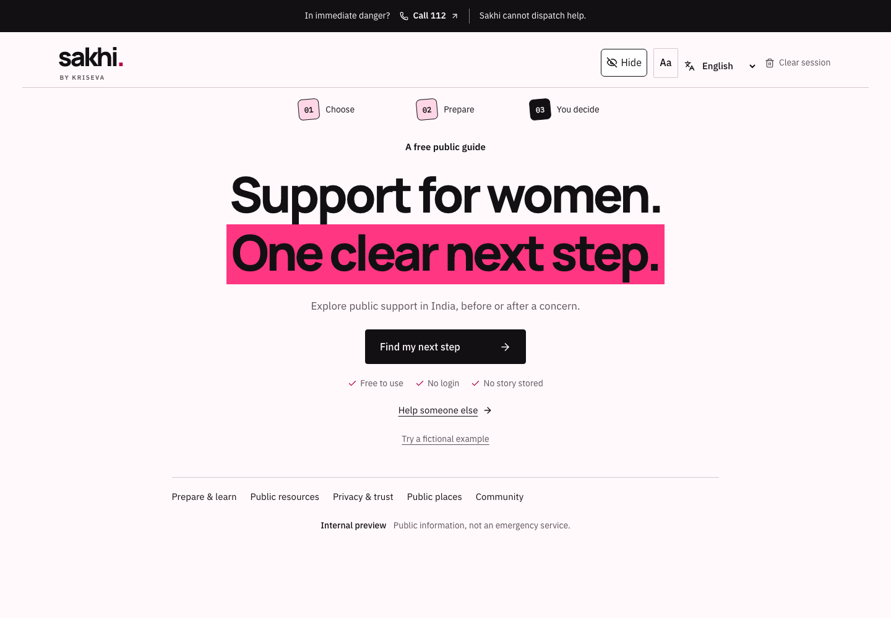
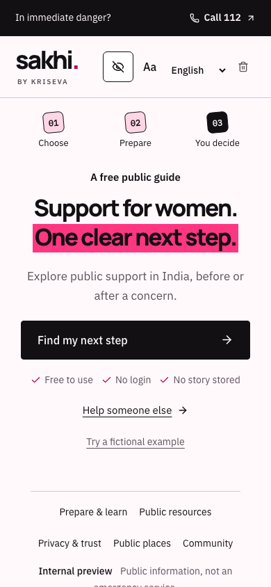
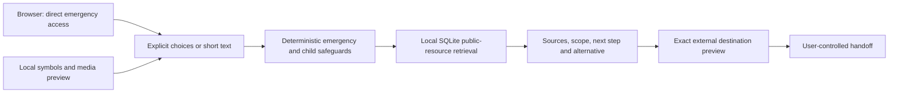

<div align="center">

# sakhi.

### A little clarity. A next step you control.

A noncommercial, public-interest support navigator for women in India.

[](https://github.com/Kriseva-AI/sakhi/actions/workflows/ci.yml)
[](LICENSE)

**Internal review preview** · **No account** · **No paid API key** · **Community contributions welcome**

[Run locally](#run-locally) · [What works](#what-works) · [Contribute](CONTRIBUTING.md) · [Release gates](docs/RELEASE_GATES.md)

</div>

**Immediate danger in India:** call112 if you can. [Official emergency information](https://112.gov.in/). Sakhi is a navigator; it does not provide emergency response, counselling or legal representation. No institutional affiliation or guaranteed service availability is claimed.

<table>
<tr><td width="70%"></td><td width="30%"></td></tr>
</table>

Sakhi helps someone explore a concern, prepare useful questions and understand public support options without creating an account or telling a whole story. It keeps the next action visible and distinguishes a local draft, an external opening, a user-reported event and an unobserved delivery.

## What works

| Journey | Current behaviour | Important boundary |
| --- | --- | --- |
| Immediate help | Direct112 link exists in HTML before JavaScript or API calls | No dispatch, call monitoring or silent rescue connection |
| Find support | Four goals, age-aware choices, optional short text and local public-resource retrieval | Eligibility and availability remain the service's decision |
| Online abuse / under18 | One useful clarification, conditional source-backed pathways and Indian alternatives | No intimate-image collection; unknown eligibility stays unknown |
| Communicate without typing | Symbol + text board, correction and explicit confirmation | English labels; physical switch/eye-gaze acceptance pending |
| Voice notes, audio and video | Adult-only local recording/file playback, explicit start/stop/delete and bounded lifetime | No upload, automatic transcription or video interpretation |
| Preparation | Source-linked learning, public kits and a temporary preparation checklist | No mandatory account or stored personal case |
| Travel and trusted-person updates | Optional maps, public route facts, foreground location and exact recipient/content preview | Location permission never grants sharing consent; delivery remains unobserved |
| Language selection |22 scheduled Indian languages plus English,23 distinct readiness targets | Draft navigation labels or English fallback; full translation and human review remain open |
| Discreet controls | Local cover, clear session and explained quick exit | History, monitoring, source files and external copies can remain |
| Offline support | Integrity-checked public shell, contacts and instructions after initial loading | Live travel tools need network; cold physical offline acceptance remains open |

The directory contains211 discovery leads,7 source-reviewed preview entries and2 additional conditional guide references. Human production approvals:0. Nearby-place discovery has an unresolved live-provider reliability blocker. Granular crime zones, offender profiles, safe-route guarantees, institutional handoffs and staffed alerts are unavailable.

Read the [current release report](docs/RELEASE_REPORT.md), [blocker register](docs/BLOCKERS_2026-10-21.md) and [language review requirements](docs/TRANSLATION_REVIEW.md). Passing automated checks does not close human or operational gates.

## Run locally

Docker is the shortest path:

```sh
git clone https://github.com/Kriseva-AI/sakhi.git
cd sakhi
docker compose up --build -d
```

Open [127.0.0.1:8787/en-IN/](http://127.0.0.1:8787/en-IN/). The container binds to loopback, runs without root and uses a read-only filesystem. It needs no account, secret or model download. First builds download locked dependencies. Check port ownership before replacing an existing listener.

For development, use Node22+, uv, Python3.13 and Make:

```sh
make setup
make dev
```

Open [127.0.0.1:5173/en-IN/](http://127.0.0.1:5173/en-IN/). The launcher refuses occupied ports and stops only its own processes. Linux test hosts may also need `npx playwright install --with-deps chromium firefox webkit`.

```sh
make verify          # Python, TypeScript, browser journeys, packs and routing checks
make quality         # Measured mobile Lighthouse regression budgets
node scripts/localisation-inventory.mjs
```

Run browser suites sequentially because they share ports and trace output. Tests use synthetic fixtures. Live-provider probes and physical-device acceptance are recorded separately from fixtures. The [deployment guide](docs/DEPLOYMENT.md) covers the prepared protected-preview target and rollback requirements. There is no verified hosted deployment yet.

## How it works



| Path | Purpose |
| --- | --- |
| `apps/web` | React19, TypeScript, Vite PWA and optional Leaflet map |
| `services/api` | FastAPI, deterministic safeguards and public-data gateway |
| `packages/contracts` | Shared request/result types |
| `packages/i18n` | Canonical23-language registry, draft labels and fallback metadata |
| `data/public-seeds` | Source-linked public packs; discovery is separate from approval |
| `data/synthetic`, `tests` | Synthetic regression and failure/permission journeys |
| `docs/evidence` | Dated measurements, actual observations and their limits |

Generative models do not control emergency/minor safeguards or runtime routing. The earlier16-case English held-out comparison did not justify replacing the deterministic/local default. An unreliable local translation trial was rejected. More intelligence requires independently labelled evaluation and explicit privacy/processing consent. See the [architecture](docs/ARCHITECTURE.md), [threat model](docs/THREAT_MODEL.md) and [care/multimodal plan](docs/superpowers/plans/2026-10-20-sakhi-care-multimodal.md).

## Privacy and contribution

No advertising, narrative analytics, private-case database or mandatory account. Short text is processed by the Sakhi server without application body/access logging. Optional media stays in temporary browser memory. Only an explicitly changed language preference is persisted. Hosting logs, device monitoring and external services have separate boundaries. Read [privacy](docs/PRIVACY.md) and [security reporting](SECURITY.md) before using a preview.

Contribute a reproducible synthetic bug, an accessibility improvement, a dated authoritative source correction or a qualified language review. [Contribution guide](CONTRIBUTING.md), [issue backlog](docs/ISSUE_BACKLOG.md), [safety rules](docs/SAFETY.md), [code of conduct](CODE_OF_CONDUCT.md).

**Never put a private story, identity, intimate media, credential or case document in an issue, PR, screenshot or test.** Critical contact and translation changes require scoped human review. No popularity vote or model output grants approval.

Project code is [Apache-2.0](LICENSE). Bundled fonts and other materials retain their own notices in [third-party notices](docs/THIRD_PARTY_NOTICES.md). Sakhi's noncommercial public-interest purpose does not change the permissions of its code license. Public-service content, logos and third-party data are not relicensed as project code.
