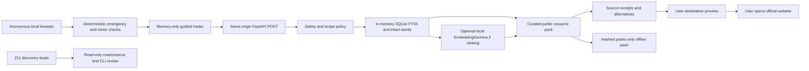

# Implemented architecture

No private-user datastore, session server, outbound agent, institutional adapter or general web-search tool is implemented. Retrieval is deterministic category selection plus vetted resource lookup. The FTS index uses Porter/Unicode61 for Latin tokens; intact Indic word matching prevents Unicode61 combining-mark fragments from becoming routing evidence. Ambiguity abstains to general options.

Optional embeddings rank only already approved lexical candidates. They cannot introduce a phone, new resource, legal statement or external action. EmbeddingGemma is an encoder, not a generative model. The tested text-only configuration uses float32 on CPU, native 768 dimensions and publisher SearchQuery/Document formats. Vision/audio encoders are disabled even though the publisher checkpoint download includes their weights. No model runs at page load, and no model is downloaded by app startup.

API contracts: packages/contracts/index.ts and generated packages/contracts/openapi.json. GET /api/health, POST /api/navigate, GET /api/maintenance. API validation errors omit rejected input. Public-only source and locale maintenance is repository/CLI driven. No remotely writable administrative surface exists.

## Sprint 2 public-only interactions

SakhiHome is a short public-support entrance with one primary finder action and optional friend/example actions. The founder's 2026-10-20 simplification moved the ephemeral before/now/after context and four-goal action desk into SupportContexts under PreparationLibrary. ResultGuide changes the next-step explanation for understand/report/support/friend, without submitting anything. PreparationLibrary contains five general learning cards linked to four source pages, with source dates, scope and pending review. These are learning references, separate from the seven service records.

PublicPathways is a manually scrollable directory index in the learning destination. ResourceCompare allows choosing up to three eligible public records; emergency and child fast lanes remain separate. A fixed public-question checklist and resource-ID-only kit generator cannot consume intake text. DataBoundary explains temporary processing, public cache and external actions from Privacy & trust. Shared pink/black tokens now theme every route; local font assets and script fallback behavior remain.

The retained legacy LocalMapHandoff component is no longer rendered. Its public Google URL builder accepts only preset coarse cities and place types. It constructs a no-key Google Maps URL without origin/GPS. buildWhatsAppCard accepts known public resource IDs and creates generic text. Both use OutboundModal to expose the exact domain, public fields and disclosure, then require a device-safety checkpoint and a user-open action. WhatsApp recipient selection and Send happen in WhatsApp; no delivery state is inferred. These retained public URL actions need no server endpoint; the new opt-in travel endpoints are described below.

Community constructs a local unsubmitted public correction file. HTTPS URLs are checked syntactically, not fetched or approved. Query fields are restricted to public numeric PIB article selectors; credentials, fragments and unknown query fields are rejected. Proposed text remains memory-only until a user deliberately downloads it. Maintainers must validate the evidence before any publication.

Only the language preference persists. Reading comfort, context, map choice and correction text are ephemeral. Clear invalidates requests, drops route state and remounts interactive screens. All synthetic-mode downloads and external continuations remain blocked, including maintenance templates. Seven Latin and ten Noto script font assets are included in the SHA-256 public-cache manifest. No runtime font CDN is used.

## Three-pillar interaction contract

SiteNavigation uses native links and preserves modifier/new-tab behavior. Initial load keeps the skip-link tab order; actual route/result changes focus the destination heading. Finder exposes a status message during lookup and aborts pending work on Back, clear or route change; request generations prevent late responses restoring discarded state. Local attempt generations also prevent an older completion changing a newer request's busy state.

ErrorSummary links to matching inline field errors, focuses after unsuccessful correction attempts, preserves nonsensitive input and sets the Error title prefix. OutboundModal starts at its title, keeps readable outgoing public fields visible, offers the encoded address as secondary detail and returns focus to the triggering control after Escape/close. Material resource eligibility and limitations remain outside collapsed provenance details.

Browser text sizes use relative units; navigation, panels and cards wrap under larger text. Dedicated Chromium/Firefox/WebKit contracts cover the principal states. Quality budgets run against an owned production listener on 8768 and fail closed on missing measurement/configuration. [QUALITY.md](QUALITY.md) records state evidence, role ownership and the distinct human gates. No actual usability sessions or physical assistive-technology approval is inferred.

## Opt-in travel gateway and local plan

TravelWorkspace replaces the abstract map. LiveMap lazily loads bundled Leaflet after a user map action. Only tile.openstreetmap.org images leave the browser; attribution remains visible, cross-origin credentials are omitted and the image referrer is origin-only. MapBoundary, tile errors, an equivalent list and the existing Google URL alternative preserve useful recovery. No map SDK is fetched externally. Public tile data is never packaged for offline use.

POST /api/explore/cities matches a 3,783-record public GeoNames gazetteer locally; only a known city ID reaches Open-Meteo for unambiguous exact matches. Unknown typed text is not forwarded. POST /places builds a fixed2 km Overpass query around a chosen public centre, caps 50 elements, removes explicitly inaccessible records and preserves unknown fields. POST /route uses the actual FOSSGIS foot/car profiles, validates bounded geometry and supplies model distance/duration. POST /weather retrieves public-city forecasts/solar times. The gateway allows four fixed HTTPS hosts, no redirect,25-second total deadlines,1.5MB responses, bounded RAM caches with original retrieval timestamps and conservative per-host limits. This is not a mass-scale quota layer.

A single frontend operation generation and AbortController prevent stale responses after cancel, city/type changes, relevant map-centre changes, revoke, unmount or Clear session. Map events only cancel area-dependent place/route requests, leaving independent city weather intact. Device-city suggestion has a separate one-shot generation, visibility invalidation and local 16-city nearest-centre lookup; raw position is never serialized, and a proposed city is not applied to an enabled map before an explicit Use city action. Conditions compares a chosen IST departure with source sunrise/sunset. TripPlan keeps an ephemeral checklist and a foreground page reminder, survives internal tool-panel changes, exposes its status across panels and ends on page exit/clear/city reset. Export contains public selections only. WhatsApp only previews a neutral user-send draft. No contacts, automatic alerts, crime-zone model, offender profiles or recipient service is introduced.

Actual external provider smoke results are separate from deterministic browser fixtures. The original211 service leads,7 preview entries,0 human approvals and all language approval states are unchanged.
