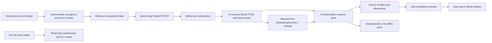

# Implemented architecture

No private-user datastore, session server, outbound agent, institutional adapter or general web-search tool is implemented. Retrieval is deterministic category selection plus vetted resource lookup. The FTS index uses Porter/Unicode61 for Latin tokens; intact Indic word matching prevents Unicode61 combining-mark fragments from becoming routing evidence. Ambiguity abstains to general options.

Optional embeddings rank only already approved lexical candidates. They cannot introduce a phone, new resource, legal statement or external action. EmbeddingGemma is an encoder, not a generative model. The tested text-only configuration uses float32 on CPU, native 768 dimensions and publisher SearchQuery/Document formats. Vision/audio encoders are disabled even though the publisher checkpoint download includes their weights. No model runs at page load, and no model is downloaded by app startup.

API contracts: packages/contracts/index.ts and generated packages/contracts/openapi.json. GET /api/health, POST /api/navigate, GET /api/maintenance. API validation errors omit rejected input. Public-only source and locale maintenance is repository/CLI driven. No remotely writable administrative surface exists.

## Sprint 2 public-only interactions

SakhiHome holds an ephemeral before/now/after context and links to four goal journeys. ResultGuide changes the next-step explanation for understand/report/support/friend, without submitting anything. PreparationLibrary contains five general learning cards linked to four source pages, with source dates, scope and pending review. These are learning references, separate from the seven service records.

PublicPathways is a manually scrollable directory index. ResourceCompare allows choosing up to three eligible public records; emergency and child fast lanes remain separate. A fixed public-question checklist and resource-ID-only kit generator cannot consume intake text. DataBoundary explains temporary processing, public cache and external actions.

LocalMapHandoff accepts only preset coarse cities and place types. It constructs a no-key Google Maps URL without origin/GPS. buildWhatsAppCard accepts known public resource IDs and creates generic text. Both use OutboundModal to expose the exact domain, public fields and disclosure, then require a device-safety checkpoint and a user-open action. WhatsApp recipient selection and Send happen in WhatsApp; no delivery state is inferred. No new server endpoint is needed for these actions.

Community constructs a local unsubmitted public correction file. HTTPS URLs are checked syntactically, not fetched or approved. Query fields are restricted to public numeric PIB article selectors; credentials, fragments and unknown query fields are rejected. Proposed text remains memory-only until a user deliberately downloads it. Maintainers must validate the evidence before any publication.

Only the language preference persists. Reading comfort, context, map choice and correction text are ephemeral. Clear invalidates requests, drops route state and remounts interactive screens. All synthetic-mode downloads and external continuations remain blocked, including maintenance templates. Six canonical Latin and ten Noto script font assets are included in the SHA-256 public-cache manifest. No runtime font CDN is used.
