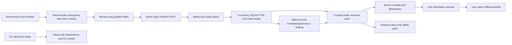

# Implemented architecture

No private-user datastore, session server, outbound agent, institutional adapter or general web-search tool is implemented. Retrieval is deterministic category selection plus vetted resource lookup. The FTS index uses Porter/Unicode61 for Latin tokens; intact Indic word matching prevents Unicode61 combining-mark fragments from becoming routing evidence. Ambiguity abstains to general options.

Optional embeddings rank only already approved lexical candidates. They cannot introduce a phone, new resource, legal statement or external action. EmbeddingGemma is an encoder, not a generative model. The tested text-only configuration uses float32 on CPU, native 768 dimensions and publisher SearchQuery/Document formats. Vision/audio encoders are disabled even though the publisher checkpoint download includes their weights. No model runs at page load, and no model is downloaded by app startup.

API contracts: packages/contracts/index.ts and generated packages/contracts/openapi.json. GET /api/health, POST /api/navigate, GET /api/maintenance. API validation errors omit rejected input. Public-only source and locale maintenance is repository/CLI driven. No remotely writable administrative surface exists.
