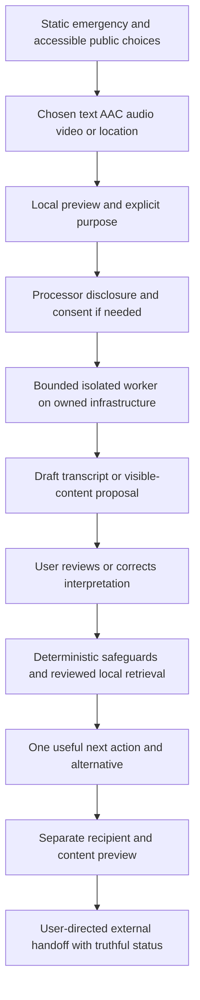

# Sakhi care, language and multimodal design

Status: execution design, not implemented or approved for launch. Founder confirmed23-language scope on2026-10-20: all22 scheduled Indian languages plus English. Baseline3db9b66; application runtimef1fcdfb. This design supersedes the earlier no-media product scope only for the explicitly requested work. It does not waive source, privacy, safeguarding or human release gates.

[Research and primary sources](../../research/multimodal-care-2026-10-20.md). [Execution plan](../plans/2026-10-20-sakhi-care-multimodal.md). [Reel/public-launch brief](../../launch/INSTAGRAM_LAUNCH_PLAN_2026-10-20.md).

## Product promise

Sakhi helps a woman communicate in the way she can, understand public support options, prepare one useful next step and retain control over what happens. Care is demonstrated by understandable choices, respectful language, useful preparation and truthful status. No claim of a human companion, therapist, legal adviser, staffed rescue service or guaranteed safety.

The founder's request for an exceptional team standard is implemented as a discipline charter, not a fictional team or percentile credential: survivor-led review; Indian safeguarding/jurisdiction expertise; disability co-design; whole-product language ownership; privacy and model evaluation; reliable mobile engineering; source and incident ownership. These roles must be assigned to real people before release.

## Design direction and page contract

Retain bold pink/black, Manrope/IBM Plex/Noto and compact emergency-first chrome. Use calm direct sentences, open space and two or three contextual visual cues. No distress photography, sirens, guilt, streaks, gamified safety scores or pressure to disclose. Deeper explanation expands on request. Neither a large statistics wall nor a long chat is the default entrance.

Home: “One useful next step, in your own way.” Primary action: “Find my next step.” Finder first offers the concrete goal, then a compact input choice: Type; Record a voice note; Add audio or video; Use symbols. Location stays a separate purpose-specific control. No device prompt, model/network request or sound on opening a page.

Every interpreted result uses a consistent care card:

1. A brief acknowledgement matched to the expressed concern, never blame or invented experience.
2. “What I understood” with the original and an editable proposed interpretation. Unclear text/time/speaker is marked uncertain.
3. One next action with why it may fit, scope, preparation and a dated source; one reliable alternative.
4. Actual progress: local draft / reviewed / opening requested / user reported / unobserved. Expand further detail rather than making it compulsory.

Illustrative copy pending safeguarding and native-language review: “You can take this one step at a time.” “You do not have to share more to see your options.” “You can decide whether to report.” “I may have misunderstood this part. Would you like to change it?” Avoid “You are safe now”, “I know exactly how you feel”, “We are watching over you”, “Why didn't you leave?” and “Your family will protect you.” No proof requirement for receiving general help.

| Page | Change |
| --- | --- |
| Home | One clear action, language/access entry and silent operation; explanation of scope kept short |
| Finder/results | Communication choices, minimal clarifications, confirmable interpretation and care card |
| Public resources | Fully translated service scope/limits; verified dates and geographic exceptions; access-channel filters only where supported |
| Prepare | Private-session preparation checklist and chosen questions; no mandatory document upload or account |
| Public places | Existing explicit map/foreground-location boundary; receipt-aware recipient update; useful provider alternative |
| Privacy & trust | Plain-language matrix for each input, processor, retention, sharing and revocation; recording always visible |
| Community | Public-source/language/accessibility contributions with governed review; prohibit private media in Issues |
| Maintenance | Per-language/per-mode approval/version/expiry, missingness, evaluation and owner gaps; no private interactions |
| Components | Semantic recorder, symbol board, transcript editor, caption player, consent checkpoint and source/uncertainty patterns |

## Users and inclusion cases

| Situation to co-design and test | Product requirement |
| --- | --- |
| Woman on shared/monitored phone | Cover/erase always reachable; no autoplay, surprise notification or stealth promise |
| Rural/older-phone user with weak connectivity | Text/AAC/offline contacts first; no mandatory model/file download; visible transfer size/cancel |
| Deaf ISL user or hard-of-hearing woman | Captions and transcript; ISL pathway separate from speech; no assumption that written Hindi/English suffices |
| Woman with limited/unreliable speech or motor control | AAC symbol/text board; keyboard/OS switch/eye-gaze operation; no speech-only flow or required long press |
| Blind/low-vision or Deafblind user | Screen-reader/keyboard semantics, readable reflow, descriptive transcript/Braille-compatible text, optional public read-aloud |
| Person with cognitive/learning access needs | Stable controls, one short question, repeat/undo and easy-read alternative; no timed comprehension gate |
| Under18 user or unsafe caregiver relationship | Immediate reviewed child pathway and accessible alternatives; no automatic parent/caregiver notification; media remains unavailable until child-specific legal/safeguarding approval |
| Woman whose chosen supporter may be unavailable/unsafe | Recipient never presumed trustworthy; review each update; fallback official/public information |
| User across caste, religion, marital status, disability, gender identity or occupation | No moral judgment or unnecessary identity collection; only sourced eligibility distinctions; review bias with consented diverse participants |

## Language scope and release meaning

Languages: Assamese, Bengali, Bodo, Dogri, Gujarati, Hindi, Kannada, Kashmiri, Konkani, Maithili, Malayalam, Manipuri/Meiteilon, Marathi, Nepali, Odia, Punjabi, Sanskrit, Santali, Sindhi, Tamil, Telugu, Urdu and English. This adds seven languages to the current16 shells. The [language/mode baseline CSV](../../evidence/multimodal-planning-2026-10-20/language-modality-baseline.csv) records actual starting status, not fabricated translation approvals.

Each language has separate states for UI/core guidance, text understanding, audio guidance, ASR, video-derived interpretation and AAC. States: unavailable / draft / review_pending / approved_scope / expired. Approval identifies content hash, named reviewer roles, exact script/mode/journey scope and expiry. No parent locale may silently stand in for an unreviewed script. Kashmiri, Sindhi, Manipuri and other script variants require explicit scope and separate evidence; additional variants are not assumed available because the language name appears.

Move all product copy, errors, resources/limits, recorder/consent text, care templates and preparation content into versioned message/content catalogues. Existing136-key coverage does not cover the entire product. Separate official names/source originals from translated explanation. No silent English fallback in a language marked approved; if a capability is absent, say so in reviewed local text and preserve useful non-media alternatives. Every language can be selected; only approved capabilities can be marketed as available.

Launch target is full reviewed public-navigation/care/AAC content in all23 languages, not just translated menus. ASR/listening/video must have a visible per-language state. The broader “all23 languages across all input modes” claim stays blocked until that entire matrix passes. Maintain a dialect/romanisation/script gap register; do not call23 languages “all Indian languages.”

## Input and consent boundaries

| Input | Minimum useful outcome | Processing and consent |
| --- | --- | --- |
| Text | Anonymous minimal note/choice; editable interpretation; local public-source retrieval | Retain existing no-log/no-persistence contract; disclose any new model processor before sending private text |
| Voice note | Explicit start/stop, visible duration, play/delete, then editable transcript | Microphone acquisition, interpretation/processor choice and external sharing are separate approvals; no auto-start or upload |
| Audio file | Local playback and selected-language transcription with uncertainty | User chooses an existing file; disclose size/duration and processor; reject unsupported codecs with record/type/AAC alternatives |
| Video file | Local muted preview; chosen segment; timestamped transcript, selected-frame visible text and confirmed notes | No autoplay, automatic camera capture or background upload; visual model output only if separately evaluated and enabled |
| Foreground location | Time/accuracy display, optional local map marker and user-confirmed coarse-area matching; chosen one-time snapshot | Acquisition does not recenter/fetch tiles or send coordinates to a model. Separately approve showing the surrounding area because map tiles disclose viewed area; snapshot/recipient approvals remain separate. No PWA background/rescue guarantee. |
| AAC symbol/text board | Compose a need with fixed symbols/labels, Yes/No/Not sure, Undo/Clear/Confirm; use it to select a reviewed path | Additional significant input mode; no AI needed, no disability/diagnosis required, no default audible speech |
| Optional still image/screenshot | Selected-region visible text and user-confirmed interpretation | Add only after the same private-media and abuse-content gates; no request for intimate images, identity documents or other people's private material |

ISL is a distinct pathway. Provide reviewed signed public guidance with captions/descriptive text, user-controlled video preview and a reviewed external relay/interpreter alternative when available. Do not ship generic automatic ISL-to-text recognition or an invented in-house interpreter. A future interpreter channel requires eligible recipients, confidential consent, access hours, safeguarding and real receipt semantics. AAC cannot be labelled a substitute for ISL.

Initial media bounds are engineering design values to profile, not measured capacity: one active artifact/session; audio or voice note<=120 seconds and10MiB; video<=60 seconds and20MiB; optional still<=8MiB and16 megapixels decoded; at most one selected10-second analysis segment and five selected frames. No intimate imagery or automated identity/age verification. If boundaries prove too expensive, narrow them visibly rather than silently truncating or claiming complete analysis.

No private file transmission occurs before the displayed processing approval. Local object URLs are revoked on discard. Recording tracks stop on stop/error/cover/hidden/unmount/revoke. Device/provider copies and previously selected originals cannot be erased by Sakhi. Browser/network failure never causes an undisclosed remote speech fallback. Declining a mode always leaves Type/AAC/public support usable.

## Interpretation, insight and facts

Use reviewed local retrieval and deterministic emergency contacts throughout. Models propose a structured interpretation; they do not create contact details, statutory deadlines, eligibility, accusations or action status. Treat transcripts, OCR and media text as untrusted data, including embedded prompt instructions. Human-readable output must identify which part was actually processed.

| Output class | Evidence needed | Example behavior |
| --- | --- | --- |
| User-confirmed observation | Original note or timestamp/selected frame plus confirmation | “You confirmed that these two messages asked for money.” No claim of authenticity or criminal intent. |
| Source fact | Versioned authoritative source, geography/date/expiry and claim ID | Explain a reporting service's public scope and preparation requirements. |
| Possible theme | At least two confirmed observations plus a reviewed explanatory source | Offer “Would it help to read about repeated unwanted contact?” rather than identifying a stalker or calculating lethality. |
| Uncertainty/missingness | Explicit absent/unprocessed/conflicting information | Ask one useful clarification or provide a safe general alternative. |
| Practical suggestion | Requested goal, confirmed facts and reviewed public pathway | Prepare a short question/checklist the user can edit; never imply submission or guaranteed eligibility. |

No facial/offender recognition, emotion/credibility detection, lie/deepfake verdict, coercive-control diagnosis, legal culpability or neighbourhood risk scoring. Do not infer a disability, religion, caste, sexuality or relationship from voice/images. No crowd/private-data patterns across people. Session-local user patterns are opt-in, reviewable and discarded on clear. Personal histories, multi-day predictions and encrypted case vaults are separate future work, not prerequisites for public help.

Intelligence is useful when it reduces uncertainty or preparation work. Do not flood a distressed person with facts. Default to one relevant insight and next action, with expandable provenance. Macro statistics require a separate curated data register with publication/observation dates, denominators, geography, source revisions and missingness; they cannot certify safety. No new crime dataset is claimed here.

## Architecture and data lifetime

Retain React/TypeScript/FastAPI/local retrieval and the existing PWA. Add a lazy input workspace, capability registry, versioned care content, local AAC and an optional isolated owned media worker. No blanket cloud-provider switch or frontend framework rewrite. Core emergency/offline use works with the media worker disabled.

The media worker has no general outbound network, no object-store backup, no training reuse and no narrative/access logs. Use a bounded tmpfs scratch area and random capability-protected jobs, not original filenames or user narratives as identifiers. Proposed limits: two running jobs, four queued,45-second processing timeout,90-second upload timeout, five-minute absolute job expiry and immediate cancellation/deletion attempt. Enforce encoded and decoded-size/compute bounds before costly processing, sandbox the decoder and pin its build/codec licences. Clean up after crash/restart and test it; do not promise secure memory erasure.

A position overlay may render locally over an already loaded map without causing a provider request. Recentring/loading surrounding tiles needs a separate area disclosure/approval. Position input to care/matching uses a user-confirmed public city ID, not raw coordinates fed to a model. Remove the marker/reading on stop, expiry, hide, revoke and page exit.

Privacy statements must match the actual enabled flags. Once a reviewed upload or recorder is enabled, replace the old blanket no-upload/no-microphone wording with the exact optional acquisition/processing/retention boundary, including in translated notices.

All processing approvals bind artifact revision, purpose, processor/deployment, language, selected segment and expiry. Any edit/replacement/model or recipient change invalidates approval. Use separate interpretation approval and external-recipient approval. No approval comes from generic terms, a microphone prompt or a map permission. Use same-origin protected requests with capability in a header, never a token/private payload in a URL. Failed/expired jobs cannot return data after revocation, cover, background, clear or unmount.

Microphone policy may change to self only behind the reviewed recorder flag; camera remains denied for the initial file-video scope. Add blob media playback CSP narrowly without permitting arbitrary scripts/connect destinations. No remote speech-recognition default. Optional local downloads are explicit with declared size/licence and verified hashes; startup never downloads models.

## Quality and release gates

Targets below are proposed acceptance conditions, not achieved metrics:

- Preserve current deterministic emergency, child, expiry/consent/storage tests; add each mode's permission, codec, empty/silent, low-resource, stale, background, cancellation and malicious-input states. Public contacts remain before media/model/network work.
- Every approved language has complete scoped content and independent native plus safeguarding review. Obtain at least40 independently authored critical text cases/language. Do not tune to the sealed holdout.
- For ASR candidates, collect at least50 consented fictional clips/language from at least five speakers, split by speaker across development and holdout; include dialect/romanisation/code-mixing where relevant, noise, whispered/slow/atypical speech and silence. Report missing groups. No confidential survivor recordings or voice biometrics in Git.
- Report WER/CER, critical meaning/negation/age/contact preservation, downstream routing, abstention, latency, peak memory and device failures per language/mode. Proposed promotion target>=98% critical-concept agreement and zero critical contact/negation/age errors in the finite release holdout. A good aggregate cannot hide an unsafe subgroup; failed scope stays unavailable. These thresholds are not a guarantee of reliability in the population.
- Care/insight outputs require source IDs or confirmed segment references; zero fabricated contacts/actions or critical unsupported advice in the sealed set. Red-team OCR/transcript prompt injection, false premise, victim blame, caregiver coercion and unavailable support.
- WCAG2.2 AA engineering target plus physical VoiceOver/TalkBack, keyboard, switch/eye-gaze and access-needs co-design. Test AAC labels and confirm controls without sound, literacy assumptions or timed gestures. Retain44px target design, large text/spacing and RTL/script shaping checks.
- Proposed moderated comprehension protocol: at least two consented fictional task sessions/language for first feedback, plus disability cohorts and script/dialect coverage; expand/retest on failures. This is a minimum discovery sample, not representative proof or certification. Any critical misunderstanding about sharing, help sent or eligibility blocks promotion.
- Lazy-load media/model modules. Target initial English transfer<=300KiB and LCP<=2.5s on the existing lab profile; preserve current3s regression ceiling, CLS<=0.1/TBT<=300ms. Measure actual older physical Android and low-bandwidth behavior before claims. No multi-GB model in initial PWA/install cache.
- Source/contact human verification, child/media/privacy/legal review, actual provider capacity, named incident/rollback owners and physical cold offline gate remain required. No fixture, model score or reel substitutes for them.

Public beta may open only its approved scope after those gates. A fully multimodal23-language launch needs the complete language/mode matrix accepted. Prelaunch research recruitment is a different announcement and must say early preview. Public repository, host/HTTPS/domain, incident route, safe disclosure/moderation process and actual release health must exist before the CTA is published. No calendar launch date is promised while those dependencies are unassigned.
